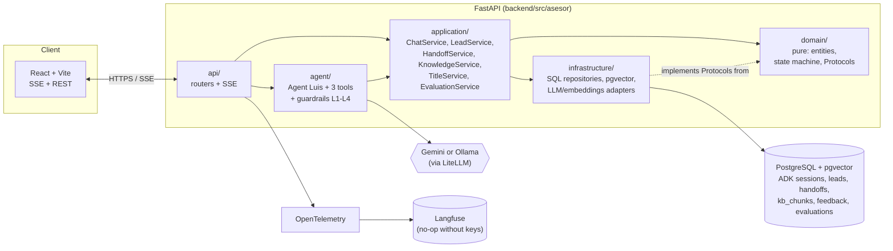
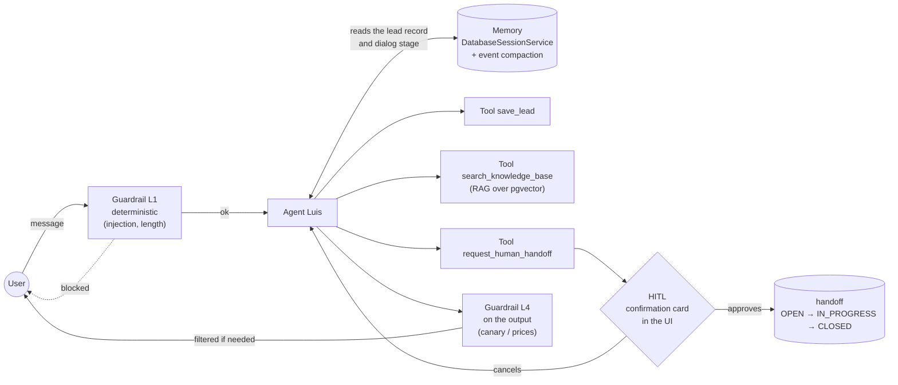
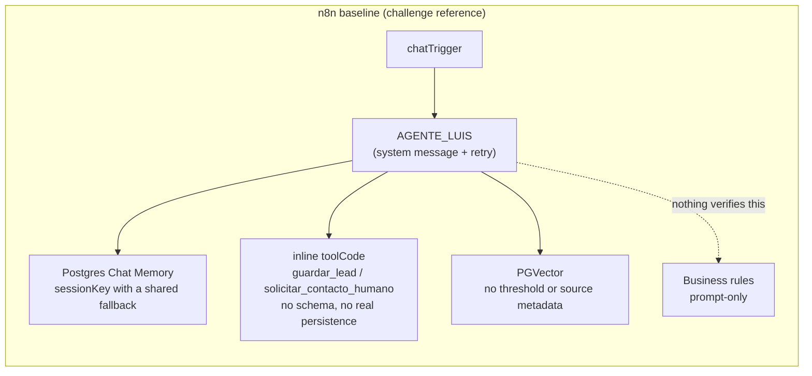
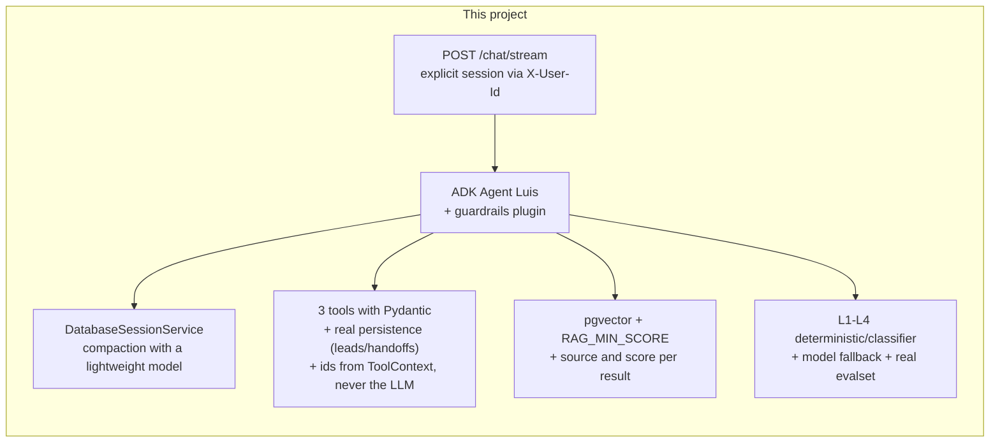

# Virtual automotive advisor

Migration of an n8n workflow into a custom backend with **Google ADK 2.x + FastAPI + React**: a conversational agent ("Luis") that guides a customer through buying a car — without tying itself to any brand or specific financing scheme — with lead capture, assisted human handoff (HITL), knowledge-base lookup (RAG), and layered guardrails.

**Runs with no API key at all**: the default profile uses local models via Ollama, bundled in the same `docker-compose.yml`. Gemini is still available as an alternative by changing two environment variables.

## Table of contents

- [Features](#features)
- [Architecture](#architecture)
- [What changes from the n8n baseline](#what-changes-from-the-n8n-baseline)
- [Quick start](#quick-start)
- [Project structure](#project-structure)
- [Commands](#commands)
- [Tests and evaluation](#tests-and-evaluation)
- [Documentation](#documentation)
- [Project status](#project-status)
- [License](#license)

## Features

- **Conversational agent** ("Luis") with its own voice and instruction, in Peru Spanish, using "tú" — built on `google-adk` (`Agent`/`Runner`/`App`), not a generic scaffold.
- **3 tools with their own contract** (spec 03): `save_lead` (structured lead capture), `request_human_handoff` (hands off to a human with prior confirmation), and `search_knowledge_base` (RAG over a general automotive knowledge base).
- **Real human-in-the-loop**: asking for a test drive or a formal quote pauses the turn with a confirmation card in the UI before a ticket is created — not a `JSON.stringify` that reaches no one.
- **RAG with a threshold and a source**: `pgvector` on the same Postgres instance, hash-based idempotent ingestion, and an honest phrase when there's no data ("I don't have the exact detail, but I'll note it down so a specialist can confirm it for you") instead of making things up.
- **Layered guardrails** (spec 07): deterministic L1 (prompt injection, length, invisible characters) with no model call, L3 on every tool call, L4 on the output (a canary token leak, prices/quotes/stock never reach the user). L2 (a fail-open classifier) is designed but not implemented — P1, it didn't block the challenge's ATs.
- **Infrastructure fallbacks**: backoff + a backup model if the primary one fails, honest degradation if the KB or the database don't respond — never a stack trace on screen.
- **Real observability**: OpenTelemetry → Langfuse (no-op without keys, the app works the same), a full trace per turn, 👍/👎 feedback, and background post-turn quality evaluation with an LLM judge.
- **Golden dataset of conversations** (`backend/tests/evalset/`): on-topic and off-script cases (prompt injection, price requests, group-savings schemes) run against the real model, not simulated.
- **Real local models, not just a demo**: an Ollama catalog discovered live (never declared by hand), a per-turn model selector in the UI, real capabilities (reasoning/tools) shown as icons.
- **Custom frontend** in React + Vite + strict TypeScript + Tailwind (shadcn/ui), typed end-to-end from the backend's OpenAPI.

## Architecture

### Why Google ADK

`google-adk` provides `Runner`, `DatabaseSessionService` (per-session memory over Postgres), and native tool confirmation (HITL) without reinventing that infrastructure, and it separates the decision-making core from the UI — an explicit requirement of the challenge. LangGraph was evaluated and ruled out due to the greater integration effort with Postgres and HITL given the available scope and timeline; keeping n8n was ruled out for not satisfying "decoupled from the UI" nor allowing production-grade tests or observability. Full detail and trade-offs in [`specs/decisions/ADR-001-framework.md`](specs/decisions/ADR-001-framework.md).

### Component view



**Dependency rule:** `api → application → domain ← infrastructure`. `domain/` imports neither ADK, FastAPI, nor SQLAlchemy — it's pure code, testable with no network. `agent/` depends on `application/`, never the other way around: the tools are thin adapters. Full detail, trade-offs, and what to revisit at scale in [`specs/01-architecture.md`](specs/01-architecture.md).

### Flow of a turn (memory, tools, HITL, and guardrails)



## What changes from the n8n baseline





| Baseline gap (detail in [`specs/00-baseline-analysis.md`](specs/00-baseline-analysis.md)) | How it was closed |
|---|---|
| `sessionKey` with a `'session_default'` fallback: sessions with no id share memory across users | Session created explicitly by the backend, no shared fallback |
| Tools with no schema, "saved" in the node's own memory, ticket via `Math.random()` | Strict Pydantic, real persistence in Postgres, ids from database PKs |
| `session_id` exposed as an argument the LLM had to fill in | `session_id`/`user_id` arrive via `ToolContext`, never from the LLM |
| Handoff with no real loop: the "ticket" never reaches anyone | Tool confirmation + a `handoffs` table with statuses and admin endpoints |
| Guardrails prompt-only, no deterministic layer | L1-L4: deterministic, classifier, on tools, and on the output |
| RAG with no threshold or governed ingestion; memory with no compaction or traces | `RAG_MIN_SCORE`, idempotent ingestion, tuned `EventsCompactionConfig`, OTel + Langfuse |
| Hardcoded, already-discontinued Vertex AI models | IDs only via env, verified against current documentation; plus a fully local, API-key-free profile |

## Quick start

Requires Docker and Docker Compose. Nothing else — the default profile needs no API key.

```bash
git clone <this-repository>
cd asesor
cp .env.example .env
docker compose up -d
```

The first run takes as long as the Ollama model downloads do (several GB); the volume keeps them across restarts, so later startups are instant. Once `docker compose ps` shows all 4 services as `healthy`, one step remains: ingesting the knowledge base (RAG) — without this, `search_knowledge_base` always returns `no_results`.

```bash
docker compose exec backend uv run python scripts/ingest_kb.py
```

- Frontend: <http://localhost:5190>
- Backend (OpenAPI): <http://localhost:8090/docs>

To use Gemini instead of the local models, change `LLM_PROVIDER=gemini` and `EMBEDDINGS_PROVIDER=gemini` in `.env`, add your `GOOGLE_API_KEY` (see the comment in `.env.example` for the rest of that profile's variables), and restart the backend.

Default ports (**8090** backend, **5190** frontend, **5490** Postgres) were deliberately chosen outside the usual ones, to coexist with other projects on the same machine — configurable via `BACKEND_PORT`/`FRONTEND_PORT`/`POSTGRES_PORT`.

## Project structure

```
backend/src/asesor/
├── api/              # FastAPI routers, DTOs, SSE, error handling
├── application/      # Use cases: ChatService, LeadService, HandoffService,
│                     # KnowledgeService, TitleService, EvaluationService
├── domain/           # Pure entities and state machine, Protocols
├── agent/            # ADK Agent "Luis", the 3 tools, guardrails L1-L4
└── infrastructure/   # SQLAlchemy repositories, pgvector, LLM/embeddings
                      # adapters, telemetry, fault injection

backend/tests/
├── unit/             # Domain and application, no network
├── integration/      # API + real Postgres, FakeLlm
├── acceptance/        # The ATs from specs/09
└── evalset/           # Golden dataset of conversations against the real model

frontend/src/
├── features/         # chat, sessions, HITL, dev panel
├── components/ui/    # shadcn/ui
└── api/              # Client typed from the backend's OpenAPI

specs/                # Source of truth for the design (00-11, decisions/, notes/)
docs/                 # UI, manual test script, demo script
kb/                   # Source documents for the knowledge base (RAG)
```

## Commands

`make` isn't installed on Windows; these are the direct equivalents (the `Makefile` is the canonical interface in CI/Linux/macOS):

```bash
cd backend && uv run ruff check . && uv run ruff format --check .   # lint
cd backend && uv run mypy                                          # typecheck
cd backend && uv run pytest                                        # tests (191, excludes live/evalset)
cd backend && uv run pytest tests/evalset -m evalset                # golden dataset against the real model (~4 min)
cd frontend && npm run typecheck && npm run build                  # frontend
docker compose exec backend uv run python scripts/ingest_kb.py     # (re)ingest the KB, inside the container
docker compose up -d                                                # brings everything up, hot-reloads
```

## Tests and evaluation

- **191 backend tests** (unit, integration, acceptance) + frontend tests (vitest), clean mypy strict and ruff.
- **Acceptance tests** (`backend/tests/acceptance/`) cover the ATs from [`specs/09-acceptance-tests.md`](specs/09-acceptance-tests.md): greeting, lead capture, anti-loop, RAG, HITL (confirm/cancel/idempotency), guardrails, and fallbacks.
- **Evalset** (`backend/tests/evalset/luis.cases.json`): on-topic and off-script conversations run against the real model with two mechanisms — tool trajectory (deterministic) and an LLM judge against rules written in Spanish. Editable by hand, no code changes needed.
- **`docs/pruebas-manuales.md`**: a script for testing by hand in the browser, describing what to expect in spirit (not exact text — an LLM doesn't always answer the same way), including the full HITL flow.

## Documentation

| Question | Where |
|---|---|
| Full specs (architecture, API contract, tools, guardrails, etc.) | [`specs/`](specs/) — indexed in [`CLAUDE.md`](CLAUDE.md) |
| Design decisions (why ADK, HITL, local models) | [`specs/decisions/`](specs/decisions/) |
| ADK signatures verified against the installed package | [`specs/notes/adk-api.md`](specs/notes/adk-api.md) |
| Phase checklist and findings from each round | [`PROGRESS.md`](PROGRESS.md) |
| Manual test script | [`docs/pruebas-manuales.md`](docs/pruebas-manuales.md) |

## Project status

Personal project built with Spec-Driven Development: 10 phases (F0–F9), each in its own branch with its own merge commit — details and findings for each in [`PROGRESS.md`](PROGRESS.md).

## License

[MIT](LICENSE).
