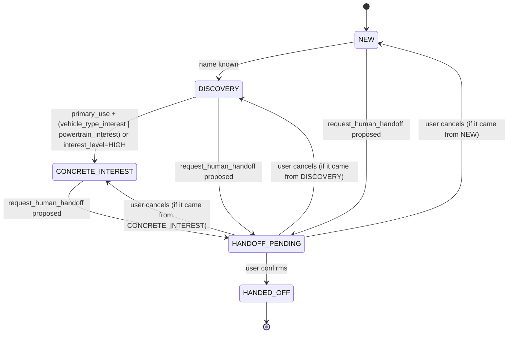

# 04 · Dialog states

The stage lives in the domain (the LLM doesn't decide it) and is recalculated every time the lead changes or a relevant tool runs. It's persisted alongside the session state (spec 06) and exposed in `lead.updated` (spec 02).

## 1. Diagram

It only ever moves forward, except for canceling out of `HANDOFF_PENDING`, which returns to the exact previous stage (`previous_stage` is saved on entering `HANDOFF_PENDING`). There's no going back from `HANDED_OFF`.

**Monotonicity (clarified in F2).** The state machine is monotonic: it recalculates the stage derived from the lead and keeps the higher of that and the current one. This means it can **skip `DISCOVERY`** if the user gives their intended use and vehicle type before their name — it goes straight from `NEW` to `CONCRETE_INTEREST`. This is intentional: blocking the jump would leave the dialog stuck at a stage that no longer describes the conversation.

## 2. Transition table

| # | Transition | Trigger | Guard | Action | Tool | SSE event |
|---|---|---|---|---|---|---|
| 1 | `NEW → DISCOVERY` | `save_lead` with `name` | `lead.name is not null` | recalculate stage | `save_lead` | `lead.updated` |
| 2 | `DISCOVERY → CONCRETE_INTEREST` | `save_lead` | `primary_use` and (`vehicle_type_interest` or `powertrain_interest`), **or** `interest_level = HIGH` | recalculate stage | `save_lead` | `lead.updated` |
| 3 | `* → HANDOFF_PENDING` | the agent proposes `request_human_handoff` | no previous stage excluded | save `previous_stage`; open confirmation | `request_human_handoff` (proposed, not yet executed) | `hitl.confirmation_required` |
| 4 | `HANDOFF_PENDING → HANDED_OFF` | user confirms | `approved = true` | execute `request_human_handoff`; create `OPEN` handoff | `request_human_handoff` (confirmed) | `lead.updated`, `tool.finished` |
| 5 | `HANDOFF_PENDING → previous_stage` | user cancels | `approved = false` | discard confirmation, restore `previous_stage` | — | `lead.updated` |

## 3. Auxiliary flags

- `just_browsing: bool` — turned on when the user says the equivalent of "I'm just browsing" (spec 05; spec 07 L1 doesn't apply here, this is an intent, not an injection). While active, the agent cuts back on proactive questions, but stage transitions keep working the same way if the user decides to move forward. Turned on via `save_lead(just_browsing=true)` — it can be sent alone, with no other field, and doesn't count as `EMPTY_UPDATE` (spec 03 §2) — which writes `SOLO_MIRANDO_KEY` to the session state (`agent/state.py`), the same way `save_lead` already wrote the stage. Verified live against the real model (F9): the message "por ahora solo estoy mirando" ("just browsing for now") triggers the tool, the canned phrase, and `GET /sessions/{id}/lead` reflects `just_browsing: true`. AT-05 (spec 09) has its own test (`test_at_agent_core.py`).
- `handoff_abierto: bool` (derived from `handoffs.status = OPEN` for the session) — if it's already `true` and the agent detects a new reason for a handoff, `request_human_handoff` is idempotent (spec 03 §3) and the stage stays at `HANDED_OFF`, with no second `HANDOFF_PENDING`.

## 4. Implementation notes

- The state machine lives in `domain/` as the pure function `next_stage(current: Stage, lead: Lead) -> Stage` (`domain/stages.py`), with no external dependencies — testable with `FakeLlm` entirely absent (it needs no LLM). It doesn't receive an explicit `event`: the next stage is derived from the resulting `Lead` itself.
- The ADK `Agent` never writes the stage; it only reads it (injected into the instruction, spec 05) and observes it in the tools' results.
- `HANDOFF_PENDING` confirmation: see spec 03 §3 and ADR-002 for the primary mechanism (native ADK tool confirmation) and the fallback (`pending_confirmation` in state + UI-driven confirmation).
